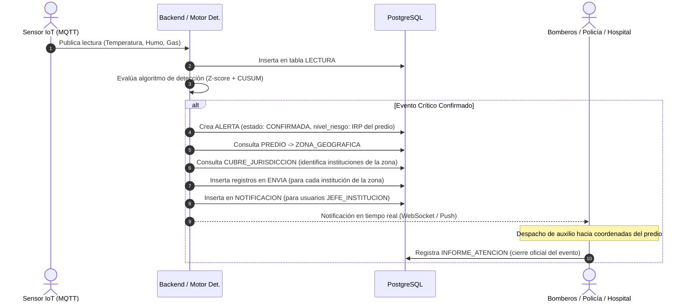

# Carga inicial: Catálogo de predios verídicos y evaluación del IRP — La Paz y El Alto

**Fecha de formulación:** 2026-10-12  
**Estado:** Propuesta técnica documentada para implementación diferida (no ejecuta inserciones inmediatas).  
**Fuente cartográfica:** OpenStreetMap (OSM) consultado mediante Nominatim y Overpass Turbo.  
**Atribución de datos:** `© OpenStreetMap contributors` bajo licencia ODbL (<https://www.openstreetmap.org/copyright>).  
**Script SQL asociado:** `predio.sql`

---

## 1. Contexto operativo y zonas geográficas identificadas

El modelo de alerta temprana y despacho ante incendios se estructura a nivel territorial a partir de las zonas geográficas operativas definidas por el equipo responsable de zonificación. Para la fase inicial de despliegue en el área metropolitana de La Paz y El Alto, se identificaron cuatro sectores estratégicos:

1. **La Paz - Centro (Municipio: La Paz):**
   - *Alcance territorial:* Casco Urbano Central, Casco Viejo, Miraflores y el entorno de la Av. Bautista Saavedra y Plaza Murillo.
   - *Dinámica operativa:* Alta densidad edilicia, concentración comercial y financiera histórica, vías angostas y topografía irregular con pendientes pronunciadas.
2. **La Paz - Norte (Municipio: La Paz):**
   - *Alcance territorial:* Sectores operativos La Portada, Villa Pabón, Periférica y laderas colindantes a la Autopista La Paz - El Alto.
   - *Dinámica operativa:* Zona residencial y comercial de ladera con mercados barriales, alta pendiente y accesos vehiculares estrechos.
3. **El Alto - Centro (Municipio: El Alto):**
   - *Alcance territorial:* Distrito 1, Ciudad Satélite y el entorno de La Ceja y la Av. Panorámica.
   - *Dinámica operativa:* Núcleo neurálgico de alta concurrencia peatonal y vehicular, mercados populosos y edificaciones residenciales-comerciales multifamiliares.
4. **El Alto - Norte (Municipio: El Alto):**
   - *Alcance territorial:* Distrito 5, Zona Brasil, eje troncal de la Av. Juan Pablo II, Villa Esperanza y el sector comercial de Río Seco.
   - *Dinámica operativa:* Amplio corredor comercial e institucional (campus universitario, mercados abiertos y ferias populares) con infraestructura variada.

---

## 2. Articulación institucional y cobertura territorial

El esquema de respuesta ante incidentes de incendio se organiza mediante instituciones multisectoriales que cubren jurisdicciones zonales:

- **Categorías de respuesta:**
  - **Bomberos:** Respuesta primaria de extinción de fuego, rescate y mitigación de siniestros.
  - **Policía:** Aseguramiento perimetral, control del orden público y desvíos de tránsito vehicular para facilitar el paso de los vehículos de emergencia.
  - **Hospitales y Centros de Salud:** Atención médica general, urgencias, soporte pediátrico y estabilización de personas afectadas.
- **Mecanismo de cobertura territorial:**
  - Las instituciones no se enlazan de forma fija con predios individuales; en su lugar, se asocian a las zonas geográficas operativas mediante la relación `cubre_jurisdiccion`.
  - Cuando un predio registra una alerta confirmada, el sistema identifica su zona geográfica e inmediatamente distribuye la notificación y la información del siniestro a todas las instituciones de auxilio que cubren esa demarcación.

---

## 3. Criterios de selección de predios reales georreferenciados

Para garantizar que las pruebas de ruteo vial, tiempos de respuesta y análisis de riesgo sean representativos de las condiciones reales, los predios fueron extraídos directamente de la cartografía oficial de OpenStreetMap:

1. **Ruteo vial efectivo (OSMnx / Grafos viales):** La red vial paceña y alteña presenta restricciones físicas severas (quebradas, gradas peatonales, puentes y avenidas de alto flujo). Utilizar predios reales con coordenadas exactas asegura que los motores de cálculo de rutas tracen trayectorias transitables desde las estaciones de bomberos hasta el lugar del incidente.
2. **Tipologías arquitectónicas admitidas:** Conforme a las reglas del modelo de dominio del backend (`backend/api/domain/predio/dtos/createPredio.dto.js`), los predios se clasifican exclusivamente en:
   - `MERCADO`
   - `EDIFICIO`
   - `VIVIENDA`
3. **Precisión geográfica:** Las coordenadas se registran con seis decimales (`Decimal(8, 6)` para latitud y `Decimal(9, 6)` para longitud) en el sistema de referencia WGS84, permitiendo precisión a nivel de manzana y fachada.
4. **Trazabilidad:** Cada inmueble cuenta con identificador de vía (`way`) o nodo (`node`) en OpenStreetMap.

---

## 4. Catálogo de los 16 predios reales seleccionados

Se seleccionaron **4 predios verídicos por zona operativa** para cubrir de forma balanceada las tipologías y perfiles de vulnerabilidad:

| Zona Operativa | Tipo | Nombre del Predio | Dirección Real de Referencia | Latitud | Longitud | Referencia OSM |
|---|---|---|---|---:|---:|---|
| **La Paz - Centro** | `MERCADO` | Mercado Lanza | Calle Evaristo Valle esq. Plaza Mayor de San Francisco | -16.494700 | -68.137460 | [way/194362248](https://www.openstreetmap.org/way/194362248) |
| **La Paz - Centro** | `EDIFICIO` | Edificio Hansa | Calle Yanacocha N° 1004 esq. Calle Mercado / Av. Mcal. Santa Cruz | -16.497020 | -68.135740 | [way/612810916](https://www.openstreetmap.org/way/612810916) |
| **La Paz - Centro** | `MERCADO` | Mercado Camacho | Av. Camacho esq. Calle Bueno, Casco Urbano Central | -16.500580 | -68.131260 | [way/232497645](https://www.openstreetmap.org/way/232497645) |
| **La Paz - Centro** | `VIVIENDA` | Inmueble Residencial Miraflores | Calle Lucas Jaimes entre Av. Busch y Díaz Romero, Miraflores | -16.504200 | -68.121500 | Sector Residencial Miraflores |
| **La Paz - Norte** | `MERCADO` | Mercado Haití | Av. Busch esq. Calle Haití, Miraflores Norte / Periférica | -16.490880 | -68.122590 | [way/437094229](https://www.openstreetmap.org/way/437094229) |
| **La Paz - Norte** | `MERCADO` | Mercado Central La Portada | Calle Justo Germán Varela esq. Calle Yapacaní, La Portada | -16.486200 | -68.163800 | Manzano Catastral La Portada |
| **La Paz - Norte** | `VIVIENDA` | Inmueble Residencial La Portada | Calle Justo Germán Varela N° 450, Zona La Portada | -16.488500 | -68.164200 | Sector Habitacional La Portada |
| **La Paz - Norte** | `EDIFICIO` | Edificio Subalcaldía Periférica | Av. Ramiro Castillo / Av. Ramos Gavilán, Periférica | -16.485500 | -68.126000 | Equipamiento Municipal Periférica |
| **El Alto - Centro** | `MERCADO` | Mercado Ciudad Satélite | Av. del Policía e/ Ballivián y Sanjinés, Plan 561, D1 | -16.524730 | -68.150750 | [way/373712502](https://www.openstreetmap.org/way/373712502) |
| **El Alto - Centro** | `MERCADO` | Mercado 12 de Octubre | Calle 2 e/ Av. Jorge Carrasco y Av. Franco Valle, Ceja / D1 | -16.520800 | -68.166450 | [way/792746582](https://www.openstreetmap.org/way/792746582) |
| **El Alto - Centro** | `EDIFICIO` | Edificio Satélite (Cholet) | Av. Alfredo Sanjinés esq. Av. Panorámica, Plan 561, D1 | -16.522800 | -68.149200 | Entorno Panorámica Satélite |
| **El Alto - Centro** | `VIVIENDA` | Vivienda Satélite Plan 405 | Calle Arturo Ballivián N° 320, Plan 405, Distrito 1 | -16.527100 | -68.148200 | Manzana Habitacional D1 |
| **El Alto - Norte** | `EDIFICIO` | Edificio Emblemático UPEA | Av. Juan Pablo II esq. Calle Sucre, Villa Esperanza, D5 | -16.491700 | -68.193600 | Campus Central UPEA |
| **El Alto - Norte** | `MERCADO` | Mercado Campesino Río Seco | Av. Juan Pablo II, Ex-Tranca Río Seco, Distrito 5 | -16.477200 | -68.204500 | Complejo Comercial Río Seco |
| **El Alto - Norte** | `EDIFICIO` | Edificio Los Andes (Cholet) | Av. Juan Pablo II esq. Calle Brasil, Zona Brasil, D5 | -16.490500 | -68.198500 | Corredor Comercial Juan Pablo II |
| **El Alto - Norte** | `VIVIENDA` | Vivienda Familiar Zona Brasil | Calle Río Beni e/ Juan Pablo II y Brasil, Zona Brasil, D5 | -16.488900 | -68.203200 | Sector Residencial Zona Brasil |

---

## 5. Metodología de evaluación del Índice de Riesgo del Predio (IRP)

### 5.1. Definición y propósito
El IRP es un valor normalizado entre $0$ y $1$ que resume la vulnerabilidad estructural ante incendios de un inmueble. Se fundamenta en la combinación de la **probabilidad de ignición** y la **magnitud de sus consecuencias**, considerando además las **medidas de protección** activas.

El IRP no se utiliza para detectar fuego (el motor de detección opera estrictamente con lecturas de sensores), sino para:
- Priorizar alertas activas en pantalla.
- Adjuntar información contextual crítica a los despachos de bomberos (material inflamable, tipo de construcción, personas en riesgo).
- Visualizar mapas de calor y vulnerabilidad territorial.

### 5.2. Los 7 parámetros ordinales de inspección

| Dimensión | Parámetro | Escala | Criterios técnicos de evaluación |
|---|---|:---:|---|
| **Probabilidad (P)** | `estado_electrico` | $1 - 3$ | **1:** Bueno (certificada, disyuntores, sin fallas visibles).<br>**2:** Regular (>20 años o alta demanda de equipos sin fallas críticas).<br>**3:** Deficiente (cableado expuesto, sobrecargas, extensiones provisionales, sin disyuntor). |
| | `estado_gas` | $0 - 2$ | **0:** Sin conexión de gas.<br>**1:** Certificado (red de gas natural domiciliaria o comercial con inspección vigente).<br>**2:** Sin certificar / precario (garrafas GLP múltiples, mangueras sin abrazaderas de seguridad). |
| | `fuentes_calor` | $0 - 2$ | **0:** Ninguna relevante.<br>**1:** Moderadas (cocinas domésticas, cafeteras, calefactores).<br>**2:** Altas (cocinas industriales continuas de mercado, hornos, talleres, soldadura). |
| **Consecuencia (C)** | `carga_combustible` | $1 - 3$ | **1:** Baja (vivienda habitual sin acopio significativo).<br>**2:** Media (depósitos de abarrotes, telas, muebles de oficina, cartón).<br>**3:** Alta (almacenamiento de químicos inflamables, solventes, pinturas, reactivos). |
| | `material_construccion` | $1 - 3$ | **1:** Incombustible (ladrillo, hormigón armado, losa de concreto).<br>**2:** Mixto (mampostería incombustible con entrepiso o cubierta de madera).<br>**3:** Combustible (adobe precario, madera predominante). |
| | `ocupacion` | $1 - 3$ | **1:** Baja (vivienda unifamiliar).<br>**2:** Media (vivienda multifamiliar, oficinas).<br>**3:** Alta (mercados municipales, universidades, comercio de afluencia masiva). |
| **Protección (M)** | `nivel_proteccion` | $0 - 3$ | **0:** Ninguna medida.<br>**1:** Extintor portátil vigente.<br>**2:** Extintor vigente y sistema de alarma centralizado.<br>**3:** Extintor, alarma y red de rociadores automáticos. |

### 5.3. Formulación matemática

1. **Normalización a $[0.1, 1.0]$:**
   $$n = 0.1 + 0.9 \cdot \frac{v - v_{\min}}{v_{\max} - v_{\min}}$$
2. **Cálculo dimensional:**
   $$P = \frac{n_{\text{elec}} + n_{\text{gas}} + n_{\text{calor}}}{3}$$
   $$C = \frac{n_{\text{carga}} + n_{\text{mat}} + n_{\text{ocup}}}{3}$$
   $$M = \frac{\text{nivel\_proteccion}}{3} \quad (M \in [0, 1])$$
3. **Cálculo del IRP final:**
   $$\text{IRP} = \sqrt{P \cdot C} \cdot (1 - 0.4 \cdot M)$$
   *(Redondeado a 3 decimales).*
4. **Categorías de riesgo:**
   - **Bajo:** $\text{IRP} < 0.33$
   - **Medio:** $0.33 \le \text{IRP} \le 0.59$
   - **Alto:** $\text{IRP} \ge 0.60$

### 5.4. Resultados calculados para los 16 predios

| Predio | $P$ | $C$ | $M$ | IRP | Categoría | Síntesis del perfil de riesgo |
|---|:---:|:---:|:---:|:---:|:---:|---|
| **Mercado Campesino Río Seco** | $1.000$ | $0.850$ | $0.000$ | **$0.922$** | **Alto** | Instalaciones eléctricas precarias, garrafas GLP sin anclaje, tinglado mixto y ausencia total de extintores. |
| **Mercado 12 de Octubre** | $1.000$ | $0.850$ | $0.333$ | **$0.799$** | **Alto** | Carga combustible densa (textiles/plásticos), cableado saturado y gran aglomeración continua. |
| **Mercado Central La Portada** | $1.000$ | $0.700$ | $0.333$ | **$0.725$** | **Alto** | Puestos de comida con freidoras comerciales, instalaciones improvisadas y tinglado mixto. |
| **Mercado Ciudad Satélite** | $0.850$ | $0.700$ | $0.333$ | **$0.669$** | **Alto** | Garrafas de GLP en área gastronómica, alta densidad de mercadería y extintores básicos. |
| **Mercado Haití** | $0.850$ | $0.700$ | $0.333$ | **$0.669$** | **Alto** | Cocinas continuas, pasillos densos, estructura de ladrillo con tinglado mixto. |
| **Mercado Lanza** | $0.850$ | $0.550$ | $0.333$ | **$0.593$** | **Medio / Alto** | Intensa actividad gastronómica con GLP, mitigada por estructura incombustible de hormigón armado. |
| **Mercado Camacho** | $0.700$ | $0.550$ | $0.667$ | **$0.455$** | **Medio** | Complejo cerrado con red de gas natural certificada y sistema de alarma/extintores de mayor cobertura. |
| **Edificio Satélite (Cholet)** | $0.550$ | $0.400$ | $0.333$ | **$0.407$** | **Medio** | Salón de eventos con carga decorativa y departamentos; estructura sólida de hormigón. |
| **Edificio Los Andes (Cholet)** | $0.550$ | $0.400$ | $0.333$ | **$0.407$** | **Medio** | Actividad comercial en galería baja y residencial superior; gas de red. |
| **Inmueble Residencial La Portada** | $0.550$ | $0.250$ | $0.333$ | **$0.321$** | **Bajo** | Vivienda multifamiliar con gas domiciliario certificado YPFB y extintor en pasillo común. |
| **Inmueble Residencial Miraflores** | $0.400$ | $0.250$ | $0.333$ | **$0.274$** | **Bajo** | Edificio residencial con disyuntores renovados, gas natural y baja carga combustible. |
| **Edificio Emblemático UPEA** | $0.250$ | $0.550$ | $0.667$ | **$0.272$** | **Bajo** | Sin instalaciones de gas, tableros institucionales protegidos y sistema de detección de humo. |
| **Vivienda Familiar Zona Brasil** | $0.550$ | $0.100$ | $0.000$ | **$0.235$** | **Bajo** | Vivienda unifamiliar con gas de red, sin extintor pero con mínima carga combustible. |
| **Edificio Hansa** | $0.250$ | $0.400$ | $0.667$ | **$0.232$** | **Bajo** | Torre corporativa de oficinas; tableros certificados, sin gas, alarma centralizada y extintores vigentes. |
| **Edificio Subalcaldía Periférica** | $0.250$ | $0.400$ | $0.667$ | **$0.232$** | **Bajo** | Edificio institucional público sin gas; brigada y equipamiento de extinción reglamentario. |
| **Vivienda Satélite Plan 405** | $0.400$ | $0.100$ | $0.333$ | **$0.173$** | **Bajo** | Vivienda unifamiliar con disyuntor, losa incombustible y extintor doméstico. |

---

## 6. Arquitectura de articulación y flujo del sistema



### Roles y asignación del IRP
1. **Flujo habitual (API REST):** El usuario o inspector en terreno ingresa únicamente los 7 parámetros de inspección física. El backend (`backend/api/domain/predio/calcularIrp.js`) calcula el IRP de forma transparente en memoria antes de persistir el registro.
2. **Carga directa por SQL:** Para evitar que los registros insertados por script nazcan con `irp = NULL`, el archivo `predio.sql` integra la fórmula matemática dentro del `INSERT`, de modo que queden inmediatamente operativos para consultas de riesgo y visualización cartográfica.

---

## 7. Procedimiento de implementación en base de datos

Cuando se determine realizar la carga en el entorno de desarrollo o producción:

1. **Zonas geográficas:** Asegurar la existencia previa de las 4 zonas operativas (`La Paz - Centro`, `La Paz - Norte`, `El Alto - Centro`, `El Alto - Norte`) en la tabla `zona_geografica`.
2. **Instituciones y Cobertura:** Asegurar el registro de las instituciones de respuesta y sus relaciones en `cubre_jurisdiccion`.
3. **Motor de detección:** Contar con al menos un registro configurado en `motor_det`.
4. **Ejecución del script de predios:** Ejecutar `predio.sql`, el cual inserta los 16 predios de forma idempotente (`WHERE NOT EXISTS`) y calcula el IRP de cada uno.

### Consulta de auditoría post-ejecución

```sql
SELECT
    z.nombre AS zona,
    p.nombre AS predio,
    p.tipo_predio,
    p.irp,
    CASE
        WHEN p.irp < 0.33 THEN 'Bajo'
        WHEN p.irp <= 0.59 THEN 'Medio'
        ELSE 'Alto'
    END AS riesgo_predio,
    i.nombre AS institucion_cobertura,
    i.categoria AS tipo_institucion
FROM predio p
JOIN zona_geografica z ON z.id_zona = p.id_zona
JOIN cubre_jurisdiccion cj ON cj.id_zona = z.id_zona
JOIN institucion i ON i.id_institucion = cj.id_institucion
ORDER BY z.nombre, p.irp DESC, i.categoria;
```
Esta consulta valida que cada predio cuente con cobertura articulada de Bomberos, Policía y Hospitales dentro de su respectiva zona operativa.
